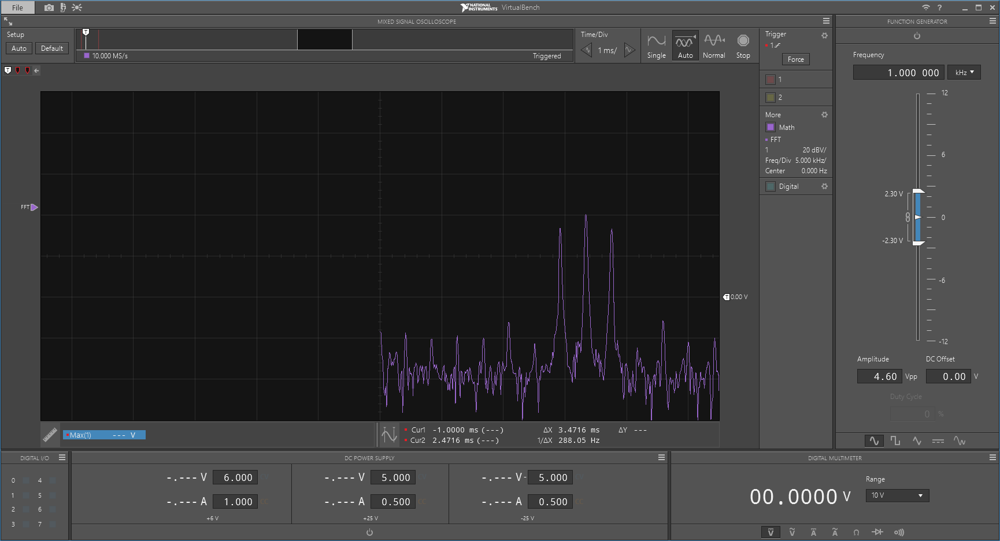
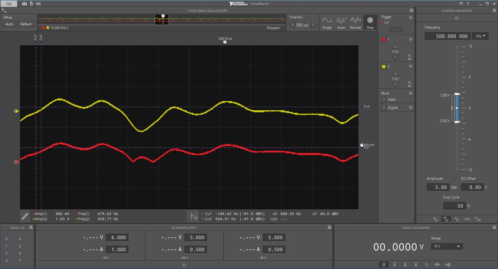
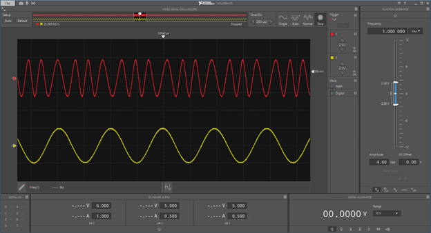
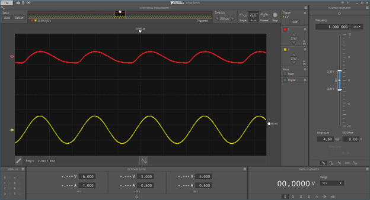
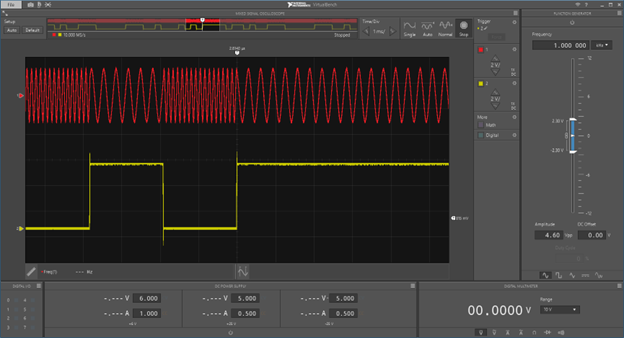
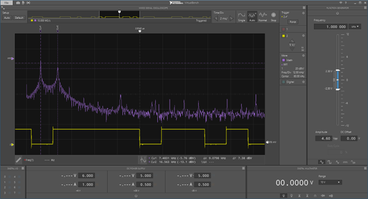
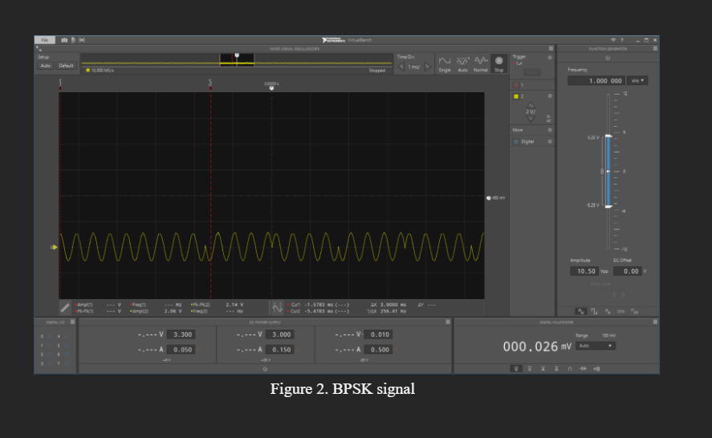
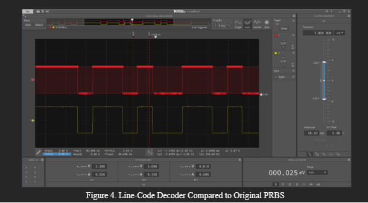

# Telecommunications Modulation and Signal Analysis

**Analog and Digital Communications | TIMS | AM | FM | FSK | BPSK | Eye Diagrams**

## Project Overview

This project documents a series of telecommunications laboratory experiments conducted using the Telecommunications Instructional Modeling System (TIMS).

The primary objective was to investigate and compare how different analog and digital modulation techniques encode information onto carrier signals, how those signals can be demodulated, and how communication channels affect signal quality.

The experiments covered **amplitude modulation (AM), frequency modulation (FM), frequency-shift keying (FSK), binary phase-shift keying (BPSK), and eye-diagram analysis**.

Using TIMS modules and laboratory measurement equipment, I configured modulation and demodulation circuits, observed signals in the time and frequency domains, and analyzed the relationships between communication-system theory and experimental results.

The project provided practical experience with signal analysis, modulation techniques, laboratory instrumentation, and digital communication fundamentals.

### Project Highlights

- Implemented and analyzed analog and digital modulation techniques using TIMS hardware.
- Compared amplitude-, frequency-, and phase-based methods of representing information.
- Examined carrier frequencies, sidebands, and modulation spectra.
- Used VCO and PLL modules for frequency modulation and demodulation.
- Observed binary phase transitions and signal recovery in BPSK.
- Investigated how different channel paths and data rates affect eye diagrams.
- Documented experimental observations and measurements in technical laboratory reports.

---

## 1. Project Objectives

- Understand how information is encoded onto carrier signals.
- Compare the operating principles of AM, FM, FSK, and BPSK.
- Configure modulation and demodulation circuits using TIMS modules.
- Analyze waveforms in the time and frequency domains.
- Investigate the relationship between carrier frequency and modulation frequency.
- Observe the behavior of binary modulation techniques.
- Evaluate channel effects using eye diagrams.
- Develop practical experience with communications laboratory equipment and experimental documentation.

---

## 2. Modulation Techniques: Comparison

The central focus of these experiments was understanding the differences between modulation techniques.

A communication system transfers information by modifying properties of a carrier signal. Different modulation methods use different carrier characteristics, creating tradeoffs involving bandwidth, noise sensitivity, complexity, and signal recovery.

### Comparison of Techniques

| Modulation | Information Representation | Experimental Focus |
|---|---|---|
| AM | Carrier amplitude varies with the message | Sideband formation and envelope recovery |
| FM | Instantaneous frequency varies with the message | VCO-based modulation and PLL demodulation |
| FSK | Discrete frequencies represent digital symbols | Binary-controlled frequency switching |
| BPSK | Two carrier phases represent binary symbols | Phase transitions and digital signal recovery |

These methods demonstrate how the same underlying information can be represented using different physical properties of a carrier wave.

The experiments focused primarily on waveform behavior, modulation and demodulation, and signal interpretation rather than a controlled comparison of bit-error rates or power efficiency.

---

## 3. Amplitude Modulation and Demodulation

Amplitude modulation varies the amplitude of a carrier signal according to the information-bearing message.

For a sinusoidal message, a conventional AM signal can be expressed as:

$$
s(t)=A_c[1+m\cos(2\pi f_m t)]\cos(2\pi f_c t)
$$

Where:

- $A_c$ = Carrier amplitude
- $m$ = Modulation index
- $f_m$ = Message frequency
- $f_c$ = Carrier frequency

Expanding this expression shows that the resulting AM signal contains three primary spectral components:

- Carrier at $f_c$
- Lower sideband at $f_c-f_m$
- Upper sideband at $f_c+f_m$

### Experimental Procedure

AM was implemented using TIMS hardware and a sinusoidal message signal.

The experiment included:

- Generating a message signal
- Applying amplitude modulation to a carrier
- Observing the resulting modulated waveform
- Examining the frequency spectrum
- Recovering the message through rectification and low-pass filtering

### Experimental Results

One experimental configuration used a **2 kHz message signal** and a **17 kHz carrier**.

The resulting frequency spectrum showed:

| Component | Frequency |
|---|---:|
| Lower sideband | 15 kHz |
| Carrier | 17 kHz |
| Upper sideband | 19 kHz |

The theoretical sideband frequencies are:

$$
f_{LSB}=17-2=15\text{ kHz}
$$

$$
f_{USB}=17+2=19\text{ kHz}
$$

The experimental observations agreed with the expected sideband locations.

The message signal was also recovered using rectification followed by low-pass filtering.

### AM Frequency Spectrum

  

**Figure 1.** Experimental AM frequency spectrum showing the 17 kHz carrier and sidebands at 15 kHz and 19 kHz.

### AM Demodulation

  

**Figure 2.** Comparison of the original message and demodulated output.

### Engineering Takeaways

- Observed how message frequency determines AM sideband spacing.
- Connected time-domain modulation with frequency-domain spectral behavior.
- Demonstrated recovery of the original message using rectification and filtering.
- Gained experience configuring and measuring an analog communications system.

---

## 4. Frequency Modulation and Demodulation

Frequency modulation carries information by changing the instantaneous frequency of a carrier while ideally maintaining constant carrier amplitude.

For a sinusoidal message, an FM signal can be represented as:

$$
s(t)=A_c\cos(2\pi f_ct+\beta\sin(2\pi f_mt))
$$

Where:

- $A_c$ = Carrier amplitude
- $f_c$ = Carrier frequency
- $f_m$ = Message frequency
- $\beta$ = Modulation index

For sinusoidal modulation:

$$
\beta=\frac{\Delta f}{f_m}
$$

where $\Delta f$ is the peak frequency deviation.

### Experimental Setup

A **voltage-controlled oscillator (VCO)** was used to produce the FM signal.

The VCO changes its output frequency in response to an applied control voltage.

The experiment examined how variations in the input message affected the frequency of the resulting carrier.

A **phase-locked loop (PLL)** was then used to recover the original information.

### FM Modulation

  

**Figure 3.** FM waveform compared with the original message signal, illustrating changes in carrier frequency.

### FM Demodulation

  

**Figure 4.** Original message compared with the signal recovered through PLL demodulation.

### Engineering Takeaways

- Observed the relationship between the control voltage and VCO output frequency.
- Implemented frequency modulation using TIMS hardware.
- Investigated the operation of a PLL-based demodulator.
- Compared frequency-based modulation with amplitude-based modulation.

---

## 5. Frequency-Shift Keying (FSK)

Frequency-shift keying is a digital modulation technique in which different carrier frequencies represent different binary symbols.

For binary FSK:

$$
s(t)=
\begin{cases}
A\cos(2\pi f_1t), & \text{binary 1}\\
A\cos(2\pi f_0t), & \text{binary 0}
\end{cases}
$$

The information is encoded through the selection of one of two frequencies.

### Experimental Setup

A binary sequence was applied to a voltage-controlled oscillator.

The changing input voltage caused the oscillator to switch between two frequency states.

The experiment used a **500 Hz sequence generator** to control the modulation.

The nominal VCO frequency for the FSK experiment was approximately **12 kHz**, with a configured frequency deviation of **±3 kHz**.

This corresponds to nominal frequency states near:

$$
f_0=12-3=9\text{ kHz}
$$

$$
f_1=12+3=15\text{ kHz}
$$

These are the configured theoretical frequency states, rather than independently verified high-precision frequency measurements.

### FSK Waveform

  

**Figure 5.** Binary input sequence and frequency-shift-keyed output showing transitions between carrier frequencies.

### FSK Frequency Spectrum

  

**Figure 6.** Frequency-domain observation of the FSK signal after applying a binary input sequence.

### Engineering Takeaways

- Demonstrated binary modulation through frequency switching.
- Observed the direct relationship between digital input voltage and VCO output frequency.
- Compared time-domain and frequency-domain representations of an FSK signal.
- Developed practical understanding of frequency-based digital modulation.

---

## 6. Binary Phase-Shift Keying (BPSK)

Binary phase-shift keying is a digital modulation method in which two carrier phases represent binary symbols.

A common representation is:

$$
s(t)=A_c\cos(2\pi f_ct+\phi)
$$

where:

$$
\phi=
\begin{cases}
0, & \text{binary 1}\\
\pi, & \text{binary 0}
\end{cases}
$$

The binary information is represented by a 180-degree phase difference between the two possible carrier states.

### Experimental Procedure

The BPSK experiment involved:

- Generating a binary input sequence
- Modulating a carrier according to the binary data
- Observing carrier phase changes
- Examining the demodulation process
- Comparing recovered data with the original input sequence

### BPSK Modulated Waveform

  

**Figure 7.** BPSK waveform demonstrating phase transitions associated with changes in the binary input.

### BPSK Demodulation

  

**Figure 8.** Comparison of the demodulated signal and original binary sequence.

### Engineering Takeaways

- Observed binary information represented through phase changes.
- Examined signal recovery using a BPSK demodulation and decision process.
- Compared phase-based digital modulation with the frequency switching used in FSK.
- Developed familiarity with digital communication signals and recovery techniques.

---

## 7. Eye Diagrams and Channel Effects

The final laboratory experiment investigated how communication-channel characteristics influence digital signal quality.

Unlike the preceding experiments, which focused primarily on modulation and demodulation, this experiment examined the behavior of digital signals passing through different channel paths.

### Eye Diagram Theory

An eye diagram is created by repeatedly overlaying segments of a digital waveform over a symbol period.

The resulting pattern provides a visual indication of signal integrity.

Important characteristics include:

- **Vertical eye opening:** Indicates amplitude margin and the effects of noise.
- **Horizontal eye opening:** Indicates timing margin.
- **Eye closure:** Can indicate distortion and intersymbol interference (ISI).
- **Crossing-point variation:** Can reveal timing uncertainty and waveform distortion.

A more open eye generally indicates more favorable conditions for reliable symbol decisions.

### Experimental Setup

A sequence generator was used to produce a digital signal using a 2 kHz input timing source.

The signal was passed through different TIMS channel paths and filters.

An oscilloscope with persistence enabled was used to visualize the resulting eye diagrams.

The experiment investigated:

- Differences between channel paths
- Changes in eye shape and opening
- Effects of increasing the signaling rate
- Signal distortion and intersymbol interference
- The influence of input waveform characteristics

### Channel Comparison

  

**Figure 9.** Eye diagram obtained through TIMS channel 1.

  

**Figure 10.** Eye diagram obtained through TIMS channel 4, illustrating the effect of a different signal path.

### Experimental Results

The laboratory report documented approximate signaling-rate limits at which the observed eye diagrams became significantly distorted.

| Channel | Reported Rate |
|---|---:|
| Channel 1 | 1.471 kHz |
| Channel 2 | 1.470 kHz |
| Channel 4 | 1.64 kHz |

These figures describe the approximate experimental rate limits recorded in the laboratory, not a formal bit-error-rate-based channel-capacity measurement.

Channel 4 exhibited a wider eye opening and supported a higher observed rate in this setup.

The differences demonstrated how channel characteristics can affect signal distortion and the ability to distinguish digital symbols.

### Eye Closure at Higher Data Rates

  

**Figure 11.** Eye diagram showing increased distortion and reduced symbol separation at a higher signaling rate.

### Engineering Takeaways

- Visualized how different channel paths affect digital signals.
- Investigated the relationship between signaling rate and intersymbol interference.
- Used eye diagrams to interpret noise margin, timing margin, and distortion.
- Observed that channel behavior can limit reliable digital signal recovery.

---

## 8. Overall Modulation Comparison

The four laboratory experiments provided experience with multiple approaches to communicating information using carrier signals.

### Summary

| Technique | Main Observation | Key Concept |
|---|---|---|
| AM | Carrier and two sidebands observed | Information encoded in amplitude |
| FM | Carrier frequency changed with message input | Continuous frequency modulation |
| FSK | Binary data switched oscillator frequency | Discrete frequency modulation |
| BPSK | Phase changes associated with binary symbols | Digital phase modulation |
| Eye Diagrams | Eye opening changed with channel and data rate | Channel effects and signal integrity |

### Key Findings

**Amplitude modulation** demonstrated the relationship between message frequency, carrier frequency, and spectral sidebands.

**Frequency modulation** illustrated how information can be encoded through changes in instantaneous frequency and recovered using a PLL.

**Frequency-shift keying** demonstrated how digital symbols can be represented by discrete carrier frequencies.

**Binary phase-shift keying** demonstrated information representation through carrier phase.

**Eye-diagram analysis** showed that reliable digital communication depends not only on modulation technique but also on channel behavior, timing, and signal quality.

These experiments were conducted under different laboratory configurations, so the results are not intended as a controlled numerical ranking of modulation performance.

---

## 9. Engineering Skills Demonstrated

| Skill | Application |
|---|---|
| Telecommunications | Analog and digital modulation fundamentals |
| Signal Analysis | Time-domain and frequency-domain waveform interpretation |
| Modulation and Demodulation | AM, FM, FSK, and BPSK |
| Spectrum Analysis | Carrier and sideband identification |
| Laboratory Instrumentation | Oscilloscope, waveform generation, and TIMS hardware |
| Oscillator Circuits | VCO-based modulation |
| Phase-Locked Loops | FM signal recovery |
| Digital Communications | Binary modulation and signal reconstruction |
| Signal Integrity | Eye diagrams, distortion, and intersymbol interference |
| Experimental Documentation | Laboratory measurements, technical reports, and data analysis |

---

## 10. Limitations and Further Development

These experiments were completed as guided telecommunications laboratory exercises.

The project demonstrates practical implementation and analysis of modulation concepts, but it does not constitute a complete independently designed wireless transceiver.

Potential extensions include:

1. **Software-Based Signal Processing**
   - Reproduce selected modulation experiments in MATLAB.
   - Compare simulated and experimental waveforms.

2. **Noise and BER Analysis**
   - Investigate bit-error rates under controlled noise conditions.
   - Compare digital modulation schemes using consistent test parameters.

3. **Spectral Analysis**
   - Investigate bandwidth and spectral occupancy.
   - Analyze how filter characteristics affect modulation and demodulation.

4. **Channel Characterization**
   - Quantify eye openings and timing margins.
   - Study intersymbol interference under different filtering conditions.

5. **Wireless Communication Integration**
   - Apply modulation concepts to an RF communication link.
   - Investigate transmission and reception using software-defined radio hardware.

---

## 11. Tools and Technologies

- Telecommunications Instructional Modeling System (TIMS)
- Oscilloscope / PicoScope
- Waveform and Sequence Generators
- Voltage-Controlled Oscillators (VCO)
- Phase-Locked Loops (PLL)
- Analog and Digital Modulation
- Frequency-Domain Signal Analysis
- Digital Signal Integrity
- Technical Laboratory Reporting

---

## 12. Project Documentation

This repository includes the original laboratory reports covering:

- Amplitude Modulation and Demodulation
- Frequency Modulation, Demodulation, and FSK
- Eye Diagram Analysis
- Binary Phase-Shift Keying

The reports contain the experimental procedures, original waveforms, observations, and supporting analysis.

---

## Author

**Josiah Germain**  
Electrical Engineering — University of Houston

[GitHub Profile](https://github.com/jgermain)
